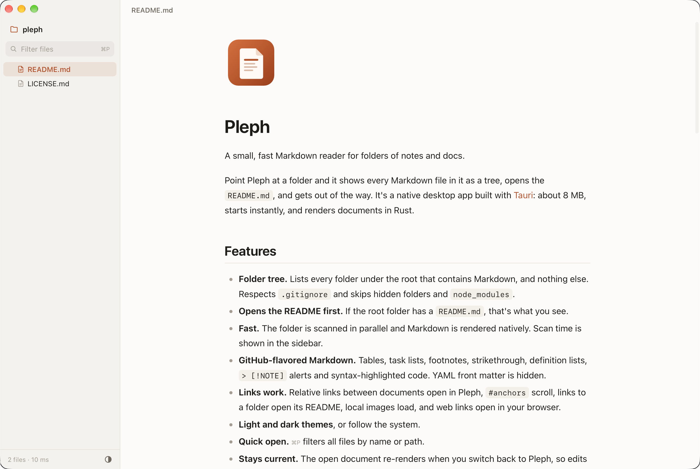

<p align="center">
  
</p>

<h1 align="center">Pleph</h1>

<p align="center">A small, fast Markdown reader for folders of notes and docs.</p>

<p align="center">
  
</p>

Point Pleph at a folder and it shows every Markdown file in it as a tree, opens the `README.md`, and
gets out of the way. It's a native desktop app built with [Tauri](https://tauri.app): about 8 MB,
starts instantly, and renders documents in Rust.

## Features

- **Folder tree.** Lists every folder under the root that contains Markdown, and nothing else.
  Respects `.gitignore` and skips hidden folders and `node_modules`.
- **Opens the README first.** If the root folder has a `README.md`, that's what you see.
- **Fast.** The folder is scanned in parallel and Markdown is rendered natively. Scan time is shown
  in the sidebar.
- **GitHub-flavored Markdown.** Tables, task lists, footnotes, strikethrough, definition lists,
  `> [!NOTE]` alerts and syntax-highlighted code. YAML front matter is hidden.
- **Links work.** Relative links between documents open in Pleph, `#anchors` scroll, links to a
  folder open its README, local images load, and web links open in your browser.
- **Light and dark themes**, or follow the system.
- **Quick open.** <kbd>⌘P</kbd> filters all files by name or path.
- **Stays current.** The open document re-renders when you switch back to Pleph, so edits made in
  another editor show up.
- **Edit in VS Code** from the right-click menu on any file.
- **`pleph` command** to open a folder or file from the terminal, like `code`.

## Install

Pleph is built from source. You need [Node.js](https://nodejs.org) and
[Rust](https://rustup.rs).

### macOS

```sh
git clone https://github.com/trondhindenes/pleph.git
cd pleph
npm install
npm run install-mac -- --open
```

This builds `Pleph.app`, copies it to `/Applications` (or `~/Applications` if that isn't writable),
writes the `pleph` command to `~/.local/bin/pleph`, and launches the app. Re-run it to update; it
refuses while Pleph is running, so quit it first (<kbd>⌘Q</kbd>). `--no-build` installs the last
build without rebuilding.

### Windows and Linux

`npm run build` produces a native installer in `src-tauri/target/release/bundle/`. Pleph has
mostly been used on macOS so far, so expect rough edges elsewhere.

## Usage

Open a folder with <kbd>⌘O</kbd> or from the terminal:

```sh
pleph                # the current folder
pleph ~/notes        # a folder
pleph docs/setup.md  # a file; its folder becomes the root
```

If Pleph is already running, the path goes to the running app: a folder that's already open gets
focus, anything else opens in a new window. Pleph remembers the last folder and document.

| Keys | Action |
|:-----|:-------|
| <kbd>⌘O</kbd> | Open folder |
| <kbd>⌘P</kbd> or <kbd>⌘K</kbd> | Filter files (<kbd>↑</kbd> <kbd>↓</kbd> <kbd>Enter</kbd> to pick, <kbd>Esc</kbd> to clear) |
| <kbd>⌘[</kbd> / <kbd>⌘]</kbd> | Back / forward |
| <kbd>⌘\\</kbd> | Show or hide the sidebar |
| <kbd>⌘R</kbd> | Rescan the folder |

Drag the sidebar edge to resize it. The button at the bottom of the sidebar switches between
system, light and dark themes.

## How it works

| Part | Where | What it does |
|:-----|:------|:-------------|
| Backend | `src-tauri/src/lib.rs` | Scans folders with [`ignore`](https://crates.io/crates/ignore), renders with [`pulldown-cmark`](https://crates.io/crates/pulldown-cmark), sanitizes with [`ammonia`](https://crates.io/crates/ammonia), forwards `pleph <path>` to the running app |
| Frontend | `src/` | Plain HTML, CSS and JavaScript, no framework or bundler. Tree, filter, navigation, themes |
| Install | `scripts/install-mac.mjs`, `scripts/pleph.sh` | Installs the app and the `pleph` command |

Rendered HTML is sanitized and the webview runs with a strict content security policy, so a
Markdown file can't run scripts.

## Development

```sh
npm install
npm run dev                         # run with hot reload of the Rust side
npm run dev -- -- -- ~/notes        # open a specific folder
cd src-tauri && cargo test          # backend tests
```

The dev build and the installed app share an app ID. While `npm run dev` is running, the `pleph`
command sends paths to the dev instance.

App icons are generated from `app-icon.svg` with `npm run icons`.

## License

[MIT](LICENSE.md)
